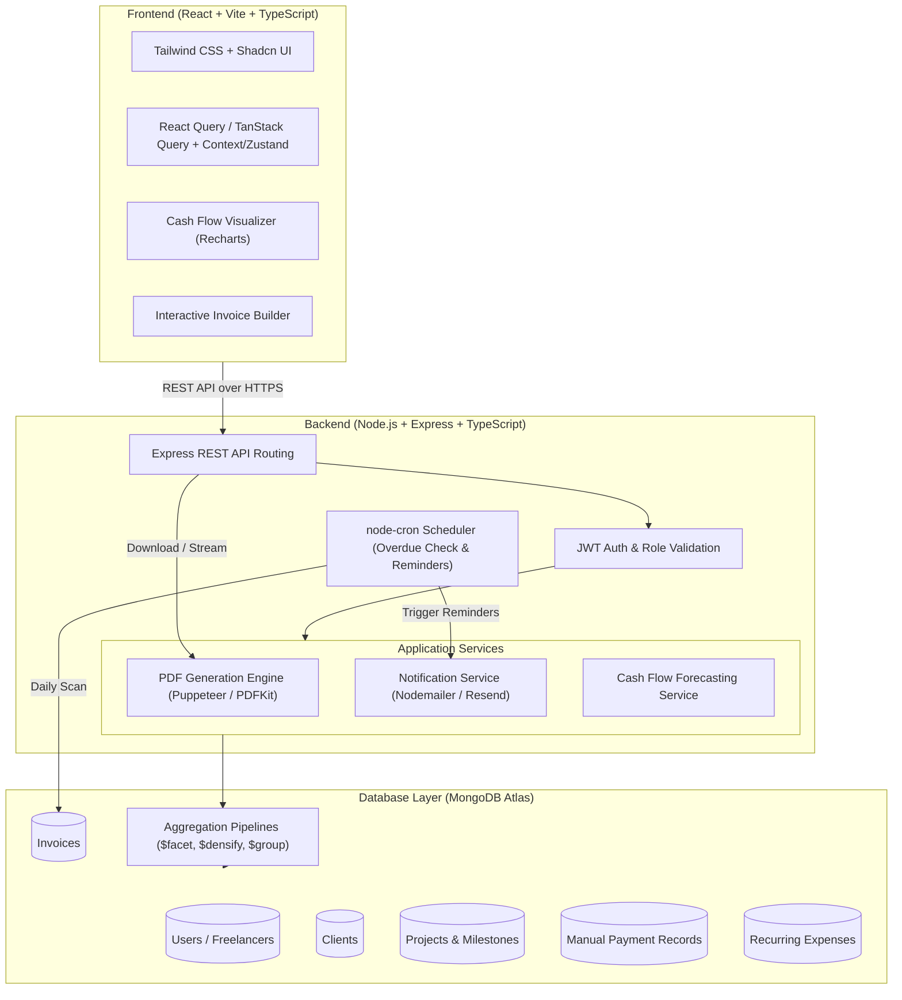
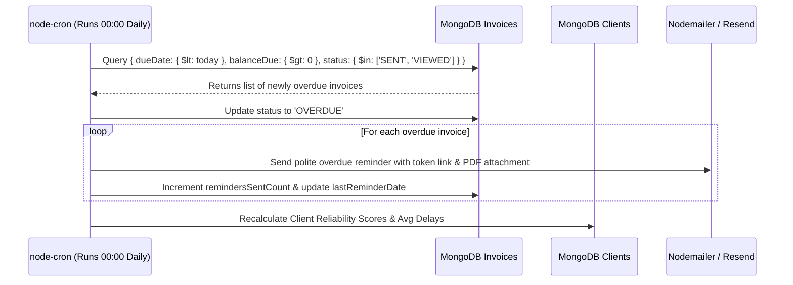

# Project Documentation: Freelance Invoice Generator & Cash Flow Forecasting Tool

**Course:** Advanced Web Development (MERN Stack)  
**Project Type:** Final Semester Capstone Project  
**Author:** Aditya (Solo Project)  
**Tech Stack:** TypeScript, React, Node.js, Express.js, MongoDB (Atlas/Mongoose)  

---

## 1. Executive Summary & Problem Statement

### 1.1 The Real-World Problem
Freelancers and independent contractors face a critical financial vulnerability: **irregular cash flow and staggered payment terms (Net 15, 30, 60, or 90 days)**. 
- Over **58% of freelancers** experience delayed payments, making personal and business budgeting unpredictable.
- Traditional invoice tools treat invoices as static documents. They assume invoices will be paid exactly on the due date, leading to inaccurate forecasting.
- Freelancers need to know: *"How much money will I actually have in my bank account over the next 30, 60, and 90 days, accounting for real client payment habits?"*

### 1.2 The Solution
An intelligent, full-stack financial platform tailored for freelancers that:
1. Streamlines client onboarding, project milestone tracking, and professional invoice generation.
2. Provides **predictive cash flow forecasting** by combining scheduled due dates with an empirical **Client Reliability & Delay Algorithm**.
3. Offloads intensive financial calculations to **high-performance MongoDB aggregation pipelines** (`$facet`, `$group`, `$densify`, `$dateTrunc`).
4. Generates high-fidelity PDF invoices on the server side with customizable branding and payment details.
5. Employs background cron jobs for automated overdue management and payment reminder scheduling.
6. Allows manual recording of payments (full and milestone/partial) with automated receipts.

---

## 2. High-Level System Architecture



---

## 3. Database Schema & Data Models (Mongoose)

### 3.1 User / Freelancer Profile (`User`)
Stores freelancer credentials, business details, currency preference, and payment details.
- `_id`: ObjectId
- `name`: String
- `email`: String (unique, indexed)
- `passwordHash`: String
- `businessName`: String
- `businessAddress`: Object (street, city, state, postalCode, country)
- `logoUrl`: String (optional)
- `taxId`: String (GSTIN / VAT / EIN)
- `currency`: String (default: `'USD'`, options: `'USD'`, `'INR'`, `'EUR'`, `'GBP'`)
- `defaultPaymentTerms`: Number (e.g., 15, 30, 45 days)
- `bankDetails`: Object (bankName, accountNumber, ifscOrRouting, upiId, wireInstructions)
- `createdAt`, `updatedAt`: Timestamps

### 3.2 Client Model (`Client`)
Stores client information and calculated payment statistics.
- `_id`: ObjectId
- `userId`: ObjectId (ref: `'User'`, indexed)
- `name`: String
- `companyName`: String
- `email`: String (indexed)
- `phone`: String
- `billingAddress`: Object
- `defaultCurrency`: String
- `customPaymentTerms`: Number (optional override)
- `notes`: String
- `reliabilityScore`: Number (calculated: 0–100 score based on historical payment punctuality)
- `avgPaymentDelayDays`: Number (average days late or early: e.g., +5 = 5 days late, -2 = 2 days early)
- `isArchived`: Boolean (default: false)
- `createdAt`, `updatedAt`: Timestamps

### 3.3 Project & Milestone Model (`Project`)
- `_id`: ObjectId
- `userId`: ObjectId (ref: `'User'`, indexed)
- `clientId`: ObjectId (ref: `'Client'`, indexed)
- `name`: String
- `description`: String
- `billingType`: Enum (`'HOURLY'`, `'FIXED_FEE'`, `'RETAINER'`)
- `rate`: Number (hourly rate or fixed total)
- `status`: Enum (`'PLANNED'`, `'IN_PROGRESS'`, `'COMPLETED'`, `'ON_HOLD'`)
- `milestones`: Array of:
  - `name`: String
  - `amount`: Number
  - `targetDate`: Date
  - `isBilled`: Boolean (default: false)
  - `invoiceId`: ObjectId (ref: `'Invoice'`, optional)
- `createdAt`, `updatedAt`: Timestamps

### 3.4 Invoice Model (`Invoice`)
The central document model of the platform.
- `_id`: ObjectId
- `userId`: ObjectId (ref: `'User'`, indexed)
- `clientId`: ObjectId (ref: `'Client'`, indexed)
- `projectId`: ObjectId (ref: `'Project'`, optional)
- `invoiceNumber`: String (unique per user, e.g. `INV-2026-001`, indexed)
- `status`: Enum:
  - `'DRAFT'`: Being drafted
  - `'SENT'`: Dispatched to client
  - `'VIEWED'`: Client opened public view link
  - `'PAID'`: Fully paid
  - `'PARTIAL'`: Partially paid
  - `'OVERDUE'`: Past due date without full settlement
  - `'CANCELLED'`: Voided
- `issueDate`: Date (indexed)
- `dueDate`: Date (indexed)
- `lineItems`: Array of:
  - `description`: String
  - `quantity`: Number
  - `unitPrice`: Number
  - `taxRate`: Number (percentage, e.g., 18%)
  - `discount`: Number (percentage or fixed)
  - `amount`: Number (computed total for line item)
- `subtotal`: Number
- `taxTotal`: Number
- `discountTotal`: Number
- `totalAmount`: Number
- `amountPaid`: Number (default: 0)
- `balanceDue`: Number (computed: `totalAmount - amountPaid`)
- `currency`: String
- `notes`: String (e.g., "Thanks for your business!")
- `paymentInstructions`: String
- `publicAccessToken`: String (UUID v4 or nanoid for secure tokenized viewing, indexed)
- `remindersSentCount`: Number (default: 0)
- `lastReminderDate`: Date
- `createdAt`, `updatedAt`: Timestamps

### 3.5 Payment Record Model (`PaymentRecord`)
Captures all manual payments and partial installments.
- `_id`: ObjectId
- `invoiceId`: ObjectId (ref: `'Invoice'`, indexed)
- `userId`: ObjectId (ref: `'User'`, indexed)
- `amount`: Number
- `paymentDate`: Date
- `paymentMethod`: Enum (`'BANK_TRANSFER'`, `'UPI'`, `'CASH'`, `'CHEQUE'`, `'PAYPAL'`, `'OTHER'`)
- `transactionReference`: String (UTR / Transaction ID)
- `notes`: String
- `recordedAt`: Date

### 3.6 Recurring Business Expenses (`RecurringExpense`)
Enables accurate net cash flow forecasting (Inflow − Outflow).
- `_id`: ObjectId
- `userId`: ObjectId (ref: `'User'`, indexed)
- `title`: String (e.g., "AWS Cloud", "Adobe Creative Cloud", "Office Rent")
- `amount`: Number
- `frequency`: Enum (`'MONTHLY'`, `'YEARLY'`, `'QUARTERLY'`)
- `billingDayOfMonth`: Number (1–28)
- `category`: Enum (`'SOFTWARE'`, `'OFFICE'`, `'EQUIPMENT'`, `'TAXES'`, `'MARKETING'`, `'OTHER'`)
- `isActive`: Boolean (default: true)

---

## 4. Advanced MongoDB Aggregation Pipelines

A major criteria for Advanced Web Development is using database-native aggregation pipelines instead of in-memory JavaScript loops. Below are the 4 core pipelines designed for this project.

### Pipeline 1: Single-Round-Trip Financial Dashboard (`$facet`)
Retrieves all core metrics in a single database round-trip for maximum performance.

```javascript
[
  { $match: { userId: new mongoose.Types.ObjectId(userId) } },
  {
    $facet: {
      // 1. KPI Cards
      summaryStats: [
        {
          $group: {
            _id: null,
            totalInvoiced: { $sum: "$totalAmount" },
            totalCollected: { $sum: "$amountPaid" },
            totalOutstanding: { $sum: "$balanceDue" },
            overdueAmount: {
              $sum: {
                $cond: [
                  { $and: [ { $gt: ["$balanceDue", 0] }, { $lt: ["$dueDate", new Date()] } ] },
                  "$balanceDue",
                  0
                ]
              }
            },
            countTotal: { $sum: 1 },
            countPaid: { $sum: { $cond: [{ $eq: ["$status", "PAID"] }, 1, 0] } },
            countOverdue: {
              $sum: {
                $cond: [
                  { $and: [ { $gt: ["$balanceDue", 0] }, { $lt: ["$dueDate", new Date()] } ] },
                  1,
                  0
                ]
              }
            }
          }
        }
      ],
      // 2. Status Breakdown
      statusBreakdown: [
        {
          $group: {
            _id: "$status",
            count: { $sum: 1 },
            totalValue: { $sum: "$totalAmount" }
          }
        }
      ],
      // 3. Trailing 6 Months Revenue History
      monthlyRevenue: [
        {
          $match: {
            status: "PAID",
            issueDate: { $gte: new Date(Date.now() - 180 * 24 * 60 * 60 * 1000) }
          }
        },
        {
          $group: {
            _id: { $dateToString: { format: "%Y-%m", date: "$issueDate" } },
            revenue: { $sum: "$amountPaid" }
          }
        },
        { $sort: { _id: 1 } }
      ]
    }
  }
]
```

### Pipeline 2: Client Reliability & Average Delay Calculator
Calculates how punctual each client is based on closed invoices.

```javascript
[
  {
    $match: {
      userId: new mongoose.Types.ObjectId(userId),
      status: "PAID",
      amountPaid: { $gt: 0 }
    }
  },
  {
    // Lookup payment records to find the final payment date
    $lookup: {
      from: "paymentrecords",
      localField: "_id",
      foreignField: "invoiceId",
      as: "payments"
    }
  },
  {
    $addFields: {
      finalPaymentDate: { $max: "$payments.paymentDate" }
    }
  },
  {
    $project: {
      clientId: 1,
      dueDate: 1,
      finalPaymentDate: 1,
      // Delay in days = (finalPaymentDate - dueDate) in milliseconds / (1000 * 60 * 60 * 24)
      delayDays: {
        $divide: [
          { $subtract: ["$finalPaymentDate", "$dueDate"] },
          1000 * 60 * 60 * 24
        ]
      }
    }
  },
  {
    $group: {
      _id: "$clientId",
      avgDelayDays: { $avg: "$delayDays" },
      paidInvoicesCount: { $sum: 1 },
      maxDelayDays: { $max: "$delayDays" },
      minDelayDays: { $min: "$delayDays" }
    }
  }
]
```

### Pipeline 3: Cash Flow Forecasting Engine
Projects incoming cash flow over 30, 60, and 90 days. It uses client delay averages to shift the projected arrival date realistically.

```javascript
[
  {
    $match: {
      userId: new mongoose.Types.ObjectId(userId),
      balanceDue: { $gt: 0 },
      status: { $in: ["SENT", "VIEWED", "PARTIAL", "OVERDUE"] }
    }
  },
  {
    $lookup: {
      from: "clients",
      localField: "clientId",
      foreignField: "_id",
      as: "clientInfo"
    }
  },
  { $unwind: { path: "$clientInfo", preserveNullAndEmptyArrays: true } },
  {
    $addFields: {
      expectedDelay: { $ifNull: ["$clientInfo.avgPaymentDelayDays", 0] },
      adjustedDueDate: {
        $add: [
          "$dueDate",
          { $multiply: [{ $ifNull: ["$clientInfo.avgPaymentDelayDays", 0] }, 24 * 60 * 60 * 1000] }
        ]
      }
    }
  },
  {
    // Group into 30-day forecasting buckets: 0-30 days, 31-60 days, 61-90 days, 90+ days
    $bucket: {
      groupBy: "$adjustedDueDate",
      boundaries: [
        new Date(),
        new Date(Date.now() + 30 * 24 * 60 * 60 * 1000),
        new Date(Date.now() + 60 * 24 * 60 * 60 * 1000),
        new Date(Date.now() + 90 * 24 * 60 * 60 * 1000),
        new Date(Date.now() + 365 * 24 * 60 * 60 * 1000)
      ],
      default: "LongTerm",
      output: {
        totalExpectedInflow: { $sum: "$balanceDue" },
        invoiceCount: { $sum: 1 },
        invoices: {
          $push: {
            invoiceNumber: "$invoiceNumber",
            clientName: "$clientInfo.name",
            amount: "$balanceDue",
            originalDueDate: "$dueDate",
            adjustedDueDate: "$adjustedDueDate"
          }
        }
      }
    }
  }
]
```

---

## 5. Server-Side PDF Engine Architecture

Instead of generating PDFs in the browser (which often look inconsistent across operating systems and cannot be attached to automated emails), the backend handles PDF generation cleanly.

### 5.1 Architecture: Puppeteer vs. PDFKit
We implement a dedicated `PDFService`:
* **Puppeteer Headless Engine:**
  - An HTML/Tailwind CSS template is compiled with invoice data (invoice number, line items, taxes, QR code, bank instructions).
  - Headless Chromium prints a clean, print-ready, vectorized A4 PDF buffer.
  - Generates beautiful modern layouts with high typographic quality.
* **Streaming Endpoint:**
  - Endpoint: `GET /api/invoices/:id/pdf`
  - Responds with `Content-Type: application/pdf` and `Content-Disposition: inline; filename="INV-2026-001.pdf"`
  - Supports direct browser preview and download.
* **Dynamic Payment QR Code:**
  - Embeds a dynamic QR code for UPI (India) or SEPA/wire details on the PDF so clients can scan and pay directly on mobile.

---

## 6. Background Automation & Cron Scheduler

Utilizes `node-cron` with transactional job handling.



1. **Daily Overdue Check (`0 0 * * *`):**
   - Detects all unpaid invoices whose `dueDate` has passed.
   - Automatically transitions status from `SENT`/`VIEWED` to `OVERDUE`.
2. **Automated Reminders:**
   - Sends automated, professional reminder emails at intervals (e.g., 3 days before due date, on due date, 7 days overdue).
3. **Weekly Client Score Recalibration:**
   - Runs Pipeline 2 once a week to refresh `avgPaymentDelayDays` and `reliabilityScore` for all active clients.

---

## 7. REST API Endpoints Specification

### Authentication & Profile (`/api/auth`)
* `POST /api/auth/register` — Register freelancer account
* `POST /api/auth/login` — Login & receive JWT
* `GET /api/auth/me` — Retrieve current user profile
* `PUT /api/auth/profile` — Update branding, bank details, tax ID, currency

### Clients (`/api/clients`)
* `GET /api/clients` — List clients (search, filter, pagination)
* `POST /api/clients` — Create new client
* `GET /api/clients/:id` — Get client details + payment history + reliability metrics
* `PUT /api/clients/:id` — Update client info
* `DELETE /api/clients/:id` — Soft-delete / archive client

### Projects & Milestones (`/api/projects`)
* `GET /api/projects` — List projects by client or status
* `POST /api/projects` — Create project with milestones
* `GET /api/projects/:id` — Project details with billed milestone status
* `PUT /api/projects/:id` — Update project / milestones
* `POST /api/projects/:id/milestones/:mId/invoice` — Convert milestone to draft invoice

### Invoices (`/api/invoices`)
* `GET /api/invoices` — List invoices (filter by status, client, date range)
* `POST /api/invoices` — Create new invoice
* `GET /api/invoices/:id` — Detailed invoice view
* `PUT /api/invoices/:id` — Edit invoice (allowed in DRAFT/SENT status)
* `DELETE /api/invoices/:id` — Delete draft invoice or cancel
* `POST /api/invoices/:id/send` — Send invoice to client via email with attached PDF
* `GET /api/invoices/:id/pdf` — Stream or download generated PDF

### Manual Payments (`/api/invoices/:id/payments`)
* `GET /api/invoices/:id/payments` — Get payment history for an invoice
* `POST /api/invoices/:id/payments` — Record manual payment (amount, date, method, transaction reference)

### Analytics & Forecasting (`/api/analytics`)
* `GET /api/analytics/dashboard` — Unified KPI dashboard (Pipeline 1)
* `GET /api/analytics/cashflow` — 30/60/90-day cash flow forecast + scenario simulation (Pipeline 3)
* `GET /api/analytics/tax-estimate` — Estimated tax liability based on collected revenue

### Public Client Portal (Tokenized, No Login Required)
* `GET /api/public/invoices/:token` — View invoice summary, line items, and bank details
* `POST /api/public/invoices/:token/viewed` — Records that the client has opened/viewed the invoice

---

## 8. Frontend Structure & Key Interfaces

Built with **React (Vite) + TypeScript + Tailwind CSS**:

1. **Dashboard Home:**
   - 4 Metric Cards: Total Outstanding, Overdue Amount, Collected this Month, Estimated Tax Reserve.
   - Interactive Cash Flow Chart (Historical actuals + Projected inflows vs. Expenses).
   - Recent Invoices and Quick Actions.

2. **Visual Invoice Builder:**
   - Real-time line item calculator (quantity, unit rate, tax%, discount%).
   - Live invoice preview toggle (desktop/print view).
   - Client selector with auto-fill of payment terms and currency.

3. **Cash Flow Visualizer & What-If Simulator:**
   - Dual-mode chart: **Actual Due Dates** vs. **Predicted Cash Flow** (using client delay factors).
   - Interactive Slider: *"Simulate Client Delay"* — see runway impact if a client is 30 days late.
   - Net Cash Runway: Deducts recurring monthly expenses to highlight potential cash shortfalls.

4. **Client & Project Manager:**
   - Client cards displaying their **Reliability Badge** (e.g., "Punctual (Avg +0 days)", "Mild Delay (+8 days)", "High Risk (+25 days)").
   - Project milestone progress trackers with one-click "Create Invoice from Milestone".

5. **Tokenized Public Client View:**
   - Clean, branded, read-only webpage for the client.
   - "Download PDF" button + Bank transfer instructions / UPI QR code display.

---

## 9. Solo-Friendly Step-by-Step Implementation Plan

| Phase | Milestone | Deliverables |
| :--- | :--- | :--- |
| **Phase 1** | **Foundation & Setup** | Project monorepo/folder structure, TypeScript setup for Client & Server, MongoDB Atlas connection, Mongoose schemas. |
| **Phase 2** | **Core Backend APIs** | Auth (JWT), Client CRUD, Project CRUD, Invoice CRUD, Manual Payment record endpoints. |
| **Phase 3** | **PDF Engine & Email** | Server-side PDF template, Puppeteer generation, Nodemailer email dispatch with PDF attachment. |
| **Phase 4** | **Aggregation & Forecast Engine** | Write & test Pipeline 1 (Dashboard `$facet`), Pipeline 2 (Client delays), Pipeline 3 (Cash flow forecast). |
| **Phase 5** | **Cron Jobs** | `node-cron` scheduled tasks for daily overdue updates and reminder triggers. |
| **Phase 6** | **Frontend Application** | React + Vite + Tailwind, Auth pages, Dashboard, Invoice Builder, Client Portal, Recharts Visualizer. |
| **Phase 7** | **Polish & Submission Prep** | Seed scripts (dummy data with realistic delayed payment histories), test suite, documentation, and viva presentation deck. |

---

## 10. Suggested Directory Layout

```text
final-project/
├── client/                     # React + Vite + TypeScript Frontend
│   ├── src/
│   │   ├── api/                # Axios / fetch API clients
│   │   ├── components/         # Reusable UI widgets, tables, modals
│   │   │   ├── ui/             # Buttons, inputs, dialogs
│   │   │   ├── invoice/        # Line item editor, invoice preview
│   │   │   └── charts/         # Recharts cash flow visualizer
│   │   ├── context/            # AuthContext, NotificationContext
│   │   ├── hooks/              # Custom React hooks
│   │   ├── pages/              # Dashboard, Invoices, Clients, Projects, Forecast, PublicInvoice
│   │   ├── types/              # Shared TypeScript definitions
│   │   └── App.tsx
│   ├── package.json
│   ├── tsconfig.json
│   └── tailwind.config.js
│
├── server/                     # Node.js + Express + TypeScript Backend
│   ├── src/
│   │   ├── config/             # DB connection, env variables
│   │   ├── controllers/        # Request handlers (invoice, client, analytics, etc.)
│   │   ├── cron/               # Scheduled jobs (overdue detector, reminders)
│   │   ├── middleware/         # Auth, validation, error handler
│   │   ├── models/             # Mongoose schemas (User, Client, Invoice, Payment, Expense)
│   │   ├── pipelines/          # Complex MongoDB aggregation pipeline definitions
│   │   ├── routes/             # Express API routes
│   │   ├── services/           # PDF generator, email service, forecast algorithm
│   │   ├── templates/          # HTML/CSS templates for invoice PDF
│   │   ├── types/              # Backend TypeScript types & DTOs
│   │   └── server.ts           # App entrypoint
│   ├── package.json
│   ├── tsconfig.json
│   └── .env.example
│
├── README.md                   # Setup guide and instructions
└── PROJECT_DOCUMENTATION.md    # Complete academic documentation
```
